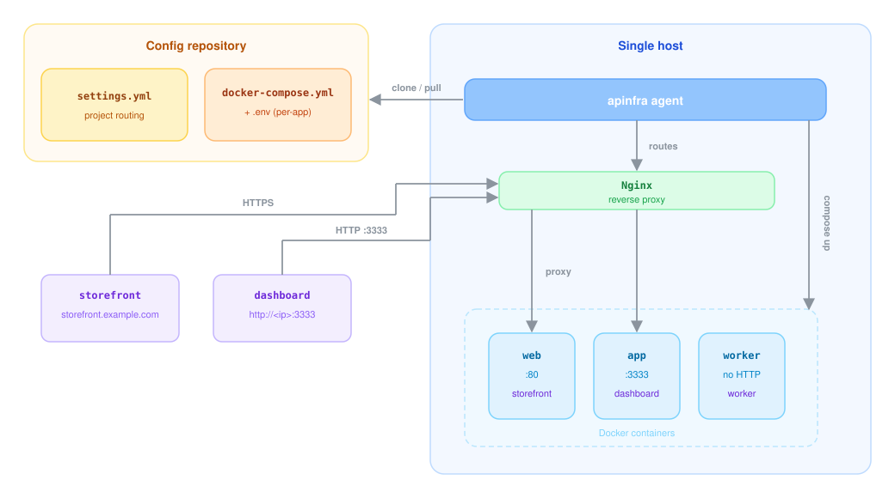

# apinfra

[](https://github.com/uservseatb/apinfra/blob/main/go.mod)
[](https://github.com/uservseatb/apinfra/releases/latest)
[](LICENSE)


**apinfra** is a lightweight GitOps agent that deploys **docker-compose** apps on a **single host**, with automatic **Nginx** reverse-proxy routing and **Let's Encrypt** / **ZeroSSL** certificates.

This project is licensed under the MIT License — see the [LICENSE](LICENSE) file for details.

## Why apinfra?

* **Lightweight:** Unlike heavy-weight self-hosted PaaS solutions, **apinfra** needs no web UI and keeps no running backend for a control panel — so practically all RAM and CPU stay available for your applications.
* **Webhookless GitOps (Pull Model):** The agent fetches configuration from Git itself, so you do not open inbound management ports, webhooks, or panels — day-to-day management goes through the configuration Git repository; no server login is required for ongoing operations.
* **Single source of truth in Git:** All settings, routes, and application configs live in one Git repository. That lets you bring up any server in the desired configuration in minutes and gives you the full GitOps toolkit — version history, reviews, rollbacks, and reproducible deploys.

## Key Features

* **GitOps Pull Workflow:** Desired server state lives in the configuration Git repository (`settings.yml` + compose files); the host periodically **pulls** and applies it.
* **Multiple Compose Files:** Ability to deploy several independent apps from one config repository — each with its own `docker-compose.yml` and optional `.env`.
* **Automatic SSL:** apinfra issues and renews Let's Encrypt / ZeroSSL (or mock) certificates; modes (`mock` / `prod` / `test` / `none`) are declared per project in `settings.yml`.
* **Nginx Reverse Proxy:** Per-project inbound rules in `settings.yml` route public domains (HTTPS/HTTP) or host ports (HTTP, or HTTPS with mock self-signed certs) to containers by Docker DNS name and target port.
* **TLS SNI Passthrough (`stream.sni`):** Share public `:443` between managed HTTPS sites and raw TLS services (such as MQTT or custom TLS backends) routed by SNI without terminating TLS at the proxy.
* **Port / host-network exposure guard:** By default, all `ports` mappings and any `network_mode: host` in docker-compose are stripped, so containers are not accidentally published on the host network stack; public access goes only through the managed Nginx routes. When needed, you can still configure port forwarding bound to a specific IP (`allow-ports-mapping: true`).
* **Lightweight & Fast:** Built with Go — minimal overhead, low memory footprint, and fast execution.

## Configuration Example: Full-Stack Web App

Here is how a typical web application (frontend + API + PostgreSQL) looks in your configuration Git repository under the `dev/` namespace:

```text
dev/
├── settings.yml
└── webapp/
    ├── docker-compose.yml
    └── .env
```

### 1. `dev/settings.yml`

Exposes the `frontend` service on `https://example.com` with an automated Let's Encrypt production certificate, while keeping `api` and `db` private inside the auto-created isolated `webapp_net` Docker network:

```yaml
version: "1.0"
projects:
  - name: webapp
    proxies:
      - inbound:
          domain-name: example.com
        target:
          service:
            name: frontend
            port: 80
        config:
          cert-issue-type: prod
          cert-acme-email: ops@example.com
```

### 2. `dev/webapp/docker-compose.yml`

Standard Compose file. Note that `ports:` are omitted (and stripped by default for security), `db` uses a named volume, and services talk to each other over Docker DNS:

```yaml
services:
  frontend:
    image: ghcr.io/example/webapp-frontend:${FRONTEND_IMAGE_TAG}
    expose:
      - "80"
    depends_on:
      - api
    restart: unless-stopped

  api:
    image: ghcr.io/example/webapp-api:${API_IMAGE_TAG}
    environment:
      DATABASE_URL: postgres://db:5432/webapp
      DATABASE_USER: webapp
      DATABASE_PASSWORD: ${DB_PASSWORD}
    depends_on:
      - db
    restart: unless-stopped

  db:
    image: postgres:16-alpine
    environment:
      POSTGRES_DB: webapp
      POSTGRES_USER: webapp
      POSTGRES_PASSWORD: ${DB_PASSWORD}
    volumes:
      - pg_data:/var/lib/postgresql/data
    restart: unless-stopped

volumes:
  pg_data:
```

### 3. Variables & Secrets (`.env`)

Non-sensitive image tags live in Git (`dev/webapp/.env`), while the secrets live on the host (`/home/ap/.env`) prefixed with the uppercase project name and a double underscore (`WEBAPP__`):

```bash
frontend.image.tag=v1.4.2
api.image.tag=v1.4.0
```

```bash
WEBAPP__DB_PASSWORD=super_secret_dev_db_password
```

```bash
namespace=dev
repo=https://<your_config_repository>

containerRegistryHost=https://<your_custom_registry>
containerRegistryUser=example-user
containerRegistryToken=ghp_your_custom_registry_token
```

## How It Works



**Flow in short:**

1. You declare projects in `settings.yml` and place each app's `docker-compose.yml` (and optional `.env`) in a matching folder.
2. The agent on the host **pulls** (clones) the configuration repository and selects the environment folder from `namespace`.
3. It validates `settings.yml` and all `docker-compose.yml` files; on any failure the cycle stops with no changes.
4. If validation succeeds, the agent compares the server state with `settings.yml` and the `docker-compose` files from the config repository. When they already match, it changes nothing; otherwise it brings up or removes containers, reconfigures the proxy, and applies related updates as needed — e.g. `domain-name` → HTTPS (or plain HTTP when `cert-issue-type: none`), or `inbound.port` → HTTP / mock HTTPS on that host port.
5. The server is ready to accept traffic and forward requests to the corresponding containers of your applications.
6. All of these steps repeat every minute via a systemd timer.

## Get Started

### 1. System Requirements

To deploy `apinfra`, you need a **clean Linux virtual machine or bare-metal server** that meets the following criteria:

* **OS:** Ubuntu 22.04 LTS (or newer).
* **Hardware:**
    * 1 vCPU and 512 MB RAM minimum.
    * *Note: A 1 GB+ Swap file is strictly required if running on 512 MB RAM.*
* **Network:** Persistent internet access (required to fetch Git repositories and Docker images).

### 2. Installation

### Option 1: Fast Installation via GitHub Releases (Recommended)

Connect to your clean Linux server (Ubuntu) via SSH and execute the following commands:

```bash
curl -L -O https://github.com/uservseatb/apinfra/releases/download/v0.5.0/apinfra_0.5.0_amd64.deb

sudo apt update
sudo apt install -y ./apinfra_*.deb
```

---

### Option 2: Local Build and Manual Installation

#### Building the Package

```bash
task package
```

Packages land in `dist/` as `apinfra_<version>_amd64.deb` and `apinfra_<version>_arm64.deb` (requires [GoReleaser](https://goreleaser.com/install/); equivalent: `goreleaser release --snapshot --clean`).

#### Transfer and Install on the Server
Copy the generated file to your target server (e.g., using `scp`) and install it:

```bash
scp dist/apinfra_*.deb user@your-server-ip:/tmp/

sudo apt update
sudo apt install -y /tmp/apinfra_*.deb
```

### After Installation

The package sets up the following on the server:
1. Creates a system user **`ap`**.
2. Deploys a **default example application** so you can verify the install right away.
3. Installs a **systemd** user service and timer for `ap` that runs the agent **once per minute**.
4. Provisions the home directory layout:
    * `/home/ap/apinfra` — Agent binary.
    * `/home/ap/.apinfra` — Host agent settings (repo, registry, …).
    * `/home/ap/.env` — Host application environment variables (secrets / project-prefixed keys).
    * `/home/ap/.trusted_images` — Allowlist for digest-pinned images with Docker socket access (see [Format](#trusted-images-trusted_images)).
    * `/home/ap/infra/` — Runtime directory for Nginx, Compose files, and certificates.

### Verifying the Installation

By default, immediately after installation, the agent safely provisions an initial demo layout to ensure your environment is working. It points to our official public [apinfra-demo-conf repository](https://github.com/uservseatb/apinfra-demo-conf) and deploys a lightweight [apinfra-demo](https://github.com/uservseatb/apinfra-demo) page.

Wait about 10–15 seconds for the containers to spin up, then open your browser at:

```text
http://<YOUR_SERVER_IP>:3333
```

If the default **apinfra-demo** page loads successfully, it means the agent, Nginx reverse proxy, and the demo container are fully operational.

Once verified, you can instantly replace the demo path with your own Git repository by adjusting the `repo` string inside `/home/ap/.apinfra`.

## Connecting Your Own Project (Server Configuration)

To connect your own projects, create a **configuration Git repository**, then point the server at it — as described below.

### Configuring `/home/ap/.apinfra`

#### 1. Configuration Repository Settings (Git)

By default, the agent points to a public example repository. To deploy your own applications, change these keys:

<table>
<thead>
<tr>
<th align="left">Property</th>
<th align="left">Description</th>
</tr>
</thead>
<tbody>
<tr bgcolor="#f6f8fa">
<td><code>namespace</code></td>
<td>The name of the environment folder inside your configuration repository (e.g., <code>dev</code>, <code>prod</code>). You can leave this as default (<code>dev</code>) during initial setup.</td>
</tr>
<tr>
<td><code>repo</code></td>
<td>The HTTPS URL of your <strong>custom configuration</strong> Git repository.</td>
</tr>
<tr bgcolor="#f6f8fa">
<td><code>repoToken</code></td>
<td>Optional. Provide a Personal Access Token (PAT) only if the configuration repository is <strong>private</strong>. Leave empty for public HTTPS repos — the agent will not attempt git authentication.</td>
</tr>
<tr>
<td><code>repoBranch</code></td>
<td>Optional. Git branch to clone. Default: <code>main</code>. If the branch does not exist in the repository, the cycle stops with an error.</td>
</tr>
</tbody>
</table>

The agent clones your configuration Git repository into memory and processes the environment directory corresponding to the host's `namespace` variable.

**Example repository directory structure:**

```text
dev/
  settings.yml
  storefront/
    docker-compose.yml
    .env
  admin/
    docker-compose.yml
    .env
  worker/
    docker-compose.yml
    .env
prod/
  settings.yml
  ...
```

> [!NOTE]
> Environment folders (`dev`, `prod`, etc.) must sit directly at the **root** of the configuration repository.

Each project folder (e.g. `storefront/`, `admin/`, `worker/`) is **one project** and must match a `projects[].name` entry in `settings.yml`. Prefer `projects[].proxies` (one Compose stack, many Nginx routes). Singular `projects[].proxy` remains a one-route compatibility alias. For Compose-backed targets, the folder has `docker-compose.yml` and an optional `.env`, and each route `target.service` (`name` + `port`) points at a service in that compose file. URL-only routes (`target.url`) do **not** require a project folder or compose file.

##### `settings.yml` Example

`settings.yml` declares projects and wires them to inbound routing:

```yaml
version: "1.0"
projects:
  - name: storefront
    enabled: true
    proxies:
      - inbound:
          domain-name: shop.example.com
        target:
          service:
            name: web
            port: 80
        config:
          cert-issue-type: prod
          cert-acme-email: ops@example.com
      - inbound:
          domain-name: api.example.com
        target:
          service:
            name: api
            port: 8080
        config:
          cert-issue-type: prod
          cert-acme-email: ops@example.com

  - name: admin
    enabled: true
    proxies:
      - inbound:
          port: 3333
        target:
          service:
            name: console
            port: 8080
        config:
          cert-issue-type: mock
      - inbound:
          domain-name: admin.example.com
        target:
          service:
            name: console
            port: 8080
        config:
          cert-issue-type: prod
          cert-acme-email: ops@example.com
    config:
      allow-ports-mapping: true

  - name: edge-api
    enabled: true
    proxy:
      inbound:
        domain-name: edge.example.com
      target:
        url: https://api.example.org
    config:
      cert-issue-type: prod
      cert-acme-email: ops@example.com

  - name: worker
    enabled: true
    config: {}
```

In this example:

* **storefront** — one Compose stack with two domain routes (`shop` → `web:80`, `api` → `api:8080`); each route has its own Nginx conf and cert mode.
* **admin** — same `console` service exposed on host port `3333` (mock TLS) and at `admin.example.com` (Let's Encrypt `prod`).
* **edge-api** — singular `proxy` compatibility form; Nginx reverse-proxies to an external URL. No compose folder required.
* **worker** — not exposed from outside (no `proxies` / `proxy`). It still runs and can reach the internet — e.g. a pull-model bot, cron-style job, or background worker.

Full field reference: [settings.yml Field Schema](#settingsyml-field-schema).

**Example `storefront/docker-compose.yml`** (services targeted by `proxies`):
```yaml
services:
  web:
    image: ghcr.io/example/storefront-web:${WEB_IMAGE_TAG}
    expose:
      - "80"
    restart: unless-stopped
  api:
    image: ghcr.io/example/storefront-api:${API_IMAGE_TAG}
    expose:
      - "8080"
    restart: unless-stopped
```

**Example `admin/docker-compose.yml`** (shared by both admin routes):
```yaml
services:
  console:
    image: ghcr.io/example/admin-console:${CONSOLE_IMAGE_TAG}
    expose:
      - "8080"
    restart: unless-stopped
```

**Example `worker/docker-compose.yml`** (no HTTP entrypoint — e.g. a background job or bot):
```yaml
services:
  worker:
    image: ghcr.io/example/worker:${WORKER_IMAGE_TAG}
    restart: unless-stopped
```

#### 2. Private Container Registry Settings (Docker)

If your compose files use public images exclusively, leave these three registry fields empty — the agent skips `docker login` and continues without failing.

<table>
<thead>
<tr>
<th align="left">Property</th>
<th align="left">Description</th>
</tr>
</thead>
<tbody>
<tr bgcolor="#f6f8fa">
<td><code>containerRegistryHost</code></td>
<td>Optional. Full URL of your private image registry (e.g., <code>https://ghcr.io</code>).</td>
</tr>
<tr>
<td><code>containerRegistryUser</code></td>
<td>Optional. Registry authentication username.</td>
</tr>
<tr bgcolor="#f6f8fa">
<td><code>containerRegistryToken</code></td>
<td>Optional. Registry personal access token or password.</td>
</tr>
</tbody>
</table>

> [!NOTE]
> Currently, `apinfra` supports authentication for **only one** private Docker registry.

---

### Configuring `/home/ap/.env`

You can inject host-specific environment variables or production secrets directly into your projects' containers from this file.

* **Crucial Rule:** Any environment variable intended for a specific application inside your compose files **must be prefixed with the project's name** (converted to uppercase) followed by a **double underscore** (`__`). The prefix is stripped before compose interpolation, so the project's `docker-compose.yml` and its `.env` in the config repository use the **unprefixed** name. Double underscore keeps nested project names (`app` / `app_billing`) from sharing host secrets.
* *Example:* If your project is named `storefront` in `settings.yml`, and you want to pass a database password, you must declare it in this file as `STOREFRONT__DB_PASSWORD=supersecret`.
* If the same variable is also defined in the project's `.env` inside the configuration repository, the value from `/home/ap/.env` on the host **overrides** it.

```yaml
services:
  web:
    image: ghcr.io/example/storefront-web:${IMAGE_TAG}
    environment:
      - DB_PASSWORD=${DB_PASSWORD}
```

```bash
IMAGE_TAG=0.3.7
```

```bash
STOREFRONT__DB_PASSWORD=supersecret
```

### Applying Changes

After modifying `/home/ap/.apinfra` or `/home/ap/.env`, you can either wait for the system timer to trigger the next deployment cycle automatically or restart the service manually to apply your changes immediately (as user `ap`):

```bash
systemctl --user start --no-block apinfra.service
```

### Viewing Service Logs

To inspect or follow the `apinfra` service logs (as user `ap`):

```bash
journalctl --user -u apinfra.service -f
```

Drop `-f` to print recent logs without following, or add `-n 200` to limit the output.

## Architecture & Design

### Managed Nginx Proxy

* **HTTP(S) reverse proxy ([proxies / proxy](#route-block-rules-proxies--singular-proxy)):** Per-project inbound rules in `settings.yml` route public domains (HTTPS/HTTP) or host ports (HTTP, or HTTPS with mock self-signed certs) to containers by Docker DNS name and target port. Certificates are issued and renewed for domain routes. Public `:80` serves ACME HTTP-01 and HTTP→HTTPS redirects.
* **TLS SNI passthrough ([stream.sni](#streamsni)):** When `stream.sni.enabled` is true, public `:443` is owned by Nginx `stream` with `ssl_preread`. Managed HTTPS domain vhosts keep terminating TLS (and ACME) but listen on the internal address `127.0.0.1:8443` inside the proxy container. SNI matching a `domain-name` is TCP-proxied there. Unmapped SNI follows `stream.sni.default` (`reject` or Compose passthrough). Port `80` stays public for ACME HTTP-01 and redirects. While SNI is enabled, host inbound port `8443` is reserved and rejected in settings.

### Security Design & Trade-offs (Pragmatic Isolation)

**apinfra** focuses on a pragmatic approach to security: strong host-level protection with high operational stability for startups and MVPs.

* **Layered Network Isolation:** Projects are strictly separated into independent `<project>_net` bridge networks. Databases and internal services stay reachable only inside Docker networks — they are not published on the host.
* **Single Shared Proxy Net:** To avoid restarting the Nginx proxy on every project routing change, all public-facing services share one `apinfra_proxy_net`. This design assumes all apps on the host belong to the same trusted boundary (tenant).
* **Zero Web UI Attack Surface:** There is no web admin panel and no open management ports on the internet — the agent works exclusively in a pull model and fetches configuration locally.
* **Strict Port Mapping:** By default, any `ports:` mappings in `docker-compose.yml` are automatically removed before start — this prevents accidental exposure of databases or internal services to the internet. If a project genuinely needs to publish ports on the server, set `config.allow-ports-mapping: true` in `settings.yml`. The agent then applies the following rules:
    * Plain port mappings (e.g. `"8080:80"`) are automatically bound to `127.0.0.1` (reachable only on the server itself).
    * Mappings that explicitly specify a concrete host network-interface IP (e.g. `"192.168.1.100:8080:80"`) are kept as written.
    * Attempts to open ports to the world via public addresses `0.0.0.0` or `::` (e.g. `"0.0.0.0:8080:80"`) are fully rejected by the agent, and the deploy cycle stops with an error.
* **Host-Network Control:** Any use of custom `network_mode` in the application's `docker-compose.yml` is forcibly removed before start. This option is fully blocked for security — all projects must stay on isolated bridge networks.
* **Privilege Escalation Protection:** Every container is started with `no-new-privileges: true`. This forbids processes inside the container from gaining new privileges after startup (e.g. via setuid/setgid binaries). Even if the application inside the container initializes as root, this layer protects the host from runtime exploits and container-escape attempts. The agent explicitly forces `privileged: false` and strips any privileged flags or dangerous capabilities to isolate containers.
* **Compose Include/Extends Guard:** `include` and `extends` are blocked to prevent host filesystem attacks via compose file composition.
* **Strict Volume & Socket Control:** Docker named volumes are allowed for writable state (e.g. database data). Absolute host binds are blocked, except `/var/run/docker.sock` for images listed in `~/.trusted_images`. Project-local relative binds (`./file`, `./dir`) under `infra/apps/<project>/` are allowed when the path exists in the config Git repo: they are synced to the host, rewritten to absolute paths, and always forced read-only (even if compose omitted `:ro` or set `:rw` / `read_only: false`). Mounting the project root, `.env`, compose files, path traversal (`../`), or any symlink (including links that stay inside the project) is rejected. Missing bind sources fail validation before `compose up` so Docker cannot create empty placeholder directories. A violation writes a `security_violation` event and aborts the cycle before `compose up`.

### Testing & Stability 🧪

Every core mechanic — including configuration validation, Nginx config rollbacks, and ACME certificate downgrades — is covered by comprehensive end-to-end tests.
Our testing suite runs inside an isolated Linux container to prevent host port collisions (`:80`/`:443`) and uses the official Let's Encrypt **Pebble** CA stub to simulate real-world production ACME failures, rate limits, and DNS preflights.
👉 Check out the test scenarios and architecture here: **[apinfra-e2e](https://github.com/uservseatb/apinfra-e2e)**

### Project `.env` and Variable Normalization
Each project folder may include an optional `.env` next to its `docker-compose.yml`. In that file you can use a dot-separated "Java-style" notation. Before evaluating the variables, the agent **normalizes** them: it replaces dots with underscores and converts strings to uppercase.

Example `.env` key in your configuration repository (`dev/storefront/.env`):
```env
web.image.tag=dev-v0.0.203
```

Your `docker-compose.yml` must reference the normalized key format:
```yaml
image: ghcr.io/example/storefront-web:${WEB_IMAGE_TAG}
```

### Certificate issuance and renewal

**apinfra** automatically manages SSL certificates for all projects configured with `domain-name` routing. The agent aims to minimize requests to external ACME providers (Let's Encrypt / ZeroSSL) and keep routing working even under network failures or hard CA rate limits.

#### How the process works (lifecycle)

1. **Issuance need check:** On every one-minute cycle the agent consults the local state file `.certs.json`. An ACME request is made only in three cases: the project has no certificate yet, the soft TTL (`issued_at` + `cert-update-time-sec`) for the active mode has elapsed, or `cert-issue-type` changed in `settings.yml`. For `prod`, cached PEMs are restored to disk first when that prod soft TTL is still valid (no CA call; `certs.prod.issued_at` is not bumped).
2. **DNS preflight:** Before sending an ACME request for `prod` or `test`, the agent resolves the domain locally (`dig +short <domain>`).
    * If the DNS record is not ready yet (empty answer) or a network error occurs, the agent simply **skips** that domain for this cycle. The error counter (`attempts`) is not increased and the mode is not downgraded. This avoids false blocks while the domain is still being delegated.
    * If `hostPublicIP` is set, the agent also requires that IP to appear in the `dig` response.
3. **Failure handling and Nginx protection:** If certificate issuance fails, **the rest of the deploy cycle is not aborted**. The agent restores that project's Nginx config from the pre-cycle snapshot. The previous working configuration keeps serving traffic.
4. **ACME rate-limit response:** If the provider returns a rate-limit error (`urn:ietf:params:acme:error:rateLimited` / HTTP 429), the agent temporarily lowers the bar (downgrade). First it tries the alternate provider (for example Let's Encrypt → ZeroSSL when EAB is configured). If both fail, it writes event `cert_rate_limited` and for `certs.downgradeCertModeHours` (default 24 hours) moves the domain to a softer mode along `prod` → `test` → `mock` → `none`. In `mock` mode a local self-signed certificate is generated so Nginx can still start.
5. **Block on persistent errors:** For ordinary non–rate-limit failures (timeouts, validation problems, etc.) the agent counts attempts in `.retries`. After `certs.triesCount` is reached, the domain is blocked for `certs.blockHours` (default 24 hours, `blocked_until`) to avoid spamming the network and give the operator time to fix the issue. The block can be cleared manually by deleting the domain entry from the file.

#### Host state files

To track status and stay idempotent, the agent uses files in the `ap` user's home directory (`/home/ap/`):

| File | Description and role |
| :--- | :--- |
| `.certs.json` | Host certificate store (`0600`): per identity `active_mode` plus a `certs` map keyed by type (`prod` / `test` / `mock` / `none`), each with its own `issued_at`. PEM blobs (`certificate` / `private_key`) are stored **only** under `certs.prod`. Also holds ACME account keys. Soft TTL for reuse/renew is `issued_at + cert-update-time-sec` (NotAfter is not used as a gate). Copy this file to a new server to restore prod certs without re-hitting Let's Encrypt. Legacy `.installedCert` and flat v1 entries are migrated automatically on first read. |
| `.downgradeCertMode` | Temporary forced mode (`prod`→`test`→`mock`→`none`) with an `until` timestamp. Created on ACME rate limit. While active it overrides `settings.yml`; after the TTL it clears itself. |
| `.retries` | Internal counter of failed issuance attempts (non–rate-limit errors). Stores `attempts`, `blocked`, and `blocked_until`. |

#### Issuance configuration (`.apinfra`)

Issuance behavior and ACME CA selection can be configured in the host agent config. Per-project certificate **mode** (`cert-issue-type`, email, refresh interval) still lives in `settings.yml`. When `.apinfra` keys are omitted, safe defaults apply:

| Property | Default | Description |
| :--- | :--- | :--- |
| `certs.provider` | `letsencrypt` | Primary ACME CA: `letsencrypt` or `zerossl`. ZeroSSL as primary requires EAB credentials below. |
| `certs.zerossl.AcmeKid` | — | ZeroSSL External Account Binding (EAB) key id. Required when `certs.provider=zerossl`. Obtain from the ZeroSSL panel. If set while the primary is Let's Encrypt, ZeroSSL is used as the rate-limit fallback CA before mode downgrade. |
| `certs.zerossl.AcmeHmac` | — | ZeroSSL EAB HMAC key. Required together with `AcmeKid` when using ZeroSSL (primary or fallback). |
| `hostPublicIP` | — | *Optional.* Expected public IP of the server. When set, local DNS preflight requires that exact IP among `dig` results. Also used as the alert-title fallback when `serverName` is empty. |
| `certs.letsencrypt.directory` | `https://acme-v02.api.letsencrypt.org/directory` | *Optional.* Let's Encrypt production ACME directory URL (lego `CADirURL`). |
| `certs.letsencrypt.stagingDirectory` | `https://acme-staging-v02.api.letsencrypt.org/directory` | *Optional.* Let's Encrypt staging ACME directory URL used for `cert-issue-type: test`. |
| `certs.zerossl.directory` | `https://acme.zerossl.com/v2/DV90` | *Optional.* ZeroSSL ACME directory URL. |
| `certs.triesCount` | `3` | Consecutive non–rate-limit failures before the domain becomes `blocked` (one increment per one-minute agent cycle). |
| `certs.blockHours` | `24` | Hours the domain stays blocked (`blocked_until`) after `triesCount` is exhausted. |
| `certs.downgradeCertModeHours` | `24` | How long the forced softer mode in `.downgradeCertMode` stays active after an ACME HTTP 429. |

## settings.yml Field Schema

### Root Level

<table>
<thead>
<tr>
<th align="left">Property</th>
<th align="left">Description</th>
</tr>
</thead>
<tbody>
<tr bgcolor="#f6f8fa">
<td><code>version</code></td>
<td><strong>Required.</strong> Schema version string. Currently used: <code>"1.0"</code>.</td>
</tr>
<tr>
<td><code>stream</code></td>
<td>Optional. Nginx <code>stream</code> settings (see [Stream Level](#stream-level)).</td>
</tr>
<tr bgcolor="#f6f8fa">
<td><code>projects</code></td>
<td><strong>Required.</strong> Array of projects to be deployed.</td>
</tr>
</tbody>
</table>

### Stream Level

Root `stream` configures Nginx `stream` features. Nested blocks are documented below.

#### `stream.sni`

Enables raw TLS passthrough on public `:443` based on SNI — useful for non-HTTP protocols (like MQTT) or backends that handle their own TLS handshake.

* **When disabled (default):** Domain HTTPS works as usual via standard Nginx `http` vhosts.
* **When enabled (`enabled: true`):**
    * **`default` (required):** Set to `reject` to drop unmapped SNI connections, or point to a fallback Compose service (`project` + `service-name` + `port`).
    * **`routes[]` (optional):** Map specific SNI hostnames directly to Compose services.
    * **Compose-only projects:** Any project referenced in `default` or `routes[]` is automatically deployed and attached to `apinfra_proxy_net`, even if it defines no HTTP `proxy` / `proxies`.

<table>
<thead>
<tr>
<th align="left">Property</th>
<th align="left">Description</th>
</tr>
</thead>
<tbody>
<tr bgcolor="#f6f8fa">
<td><code>enabled</code></td>
<td>Optional boolean. Defaults to <code>false</code> when omitted. When <code>true</code>, public <code>:443</code> uses TLS passthrough by SNI.</td>
</tr>
<tr>
<td><code>default</code></td>
<td>Required when enabled. Scalar <code>reject</code>, or mapping <code>project</code> + <code>service-name</code> + <code>port</code> (enabled project, Compose service, port <code>1..65535</code>).</td>
</tr>
<tr bgcolor="#f6f8fa">
<td><code>routes</code></td>
<td>Optional sequence. Each entry needs <code>server-name</code> (FQDN) plus the same Compose target fields as <code>default</code>. Must not collide with another route or any <code>proxy.inbound.domain-name</code>.</td>
</tr>
</tbody>
</table>

```yaml
version: "1.0"
stream:
  sni:
    enabled: true
    default: reject
    routes:
      - server-name: mqtt.example.com
        project: iot-broker
        service-name: broker
        port: 8883
projects:
  - name: storefront
    proxy:
      inbound:
        domain-name: shop.example.com
      target:
        service:
          name: web
          port: 80
  - name: iot-broker
```

### Project Level

<table>
<thead>
<tr>
<th align="left">Property</th>
<th align="left">Description</th>
</tr>
</thead>
<tbody>
<tr bgcolor="#f6f8fa">
<td><code>name</code></td>
<td><strong>Required.</strong> Unique project identifier (case-insensitive). Used as a prefix for environment variables (<code>TO_UPPER(name) + "__"</code>).</td>
</tr>
<tr>
<td><code>enabled</code></td>
<td>Optional. Defaults to <code>true</code>. If <code>false</code>, the project is bypassed during deployment cycles.</td>
</tr>
<tr bgcolor="#f6f8fa">
<td><code>proxies</code></td>
<td>Optional. Preferred form: a non-empty sequence of route objects (see route rules below). Mutually exclusive with <code>proxy</code>.</td>
</tr>
<tr>
<td><code>proxy</code></td>
<td>Optional. Compatibility alias for a single route (same shape as one <code>proxies[]</code> element). Mutually exclusive with <code>proxies</code>. If both <code>proxy</code> and <code>proxies</code> are omitted, no Nginx routes are generated (compose-only).</td>
</tr>
<tr bgcolor="#f6f8fa">
<td><code>config</code></td>
<td>Optional. Project-level settings. <code>allow-ports-mapping</code> is always project-scoped. Certificate fields here are <strong>defaults</strong> for routes that omit their own <code>config</code>.</td>
</tr>
</tbody>
</table>

### Route Block Rules (`proxies[]` / singular `proxy`)

Each route has `inbound` + `target`, plus optional per-route `config` for certificate fields.

`inbound.domain-name` and `inbound.port` are **mutually exclusive (XOR)** — exactly one must be defined.

`target.url` and `target.service` are **mutually exclusive (XOR)** — exactly one must be defined.

Inbound ports and domain names must be unique across all routes/projects in the settings file.

<table>
<thead>
<tr>
<th align="left">Property</th>
<th align="left">Description</th>
</tr>
</thead>
<tbody>
<tr bgcolor="#f6f8fa">
<td><code>inbound.domain-name</code></td>
<td>Public hostname used for Nginx routing and HTTPS certificate tracking.</td>
</tr>
<tr>
<td><code>inbound.port</code></td>
<td>Distinct host port that Nginx listens on for this route. HTTP by default (<code>cert-issue-type: none</code>); set <code>mock</code> for self-signed HTTPS on that port. Cannot be combined with <code>target.url</code>.</td>
</tr>
<tr bgcolor="#f6f8fa">
<td><code>target.service</code></td>
<td>Compose service upstream (<code>name</code> + <code>port</code>) — see table below.</td>
</tr>
<tr>
<td><code>target.url</code></td>
<td>External <code>http://</code> or <code>https://</code> origin (<code>scheme://host[:port]</code> only). <code>user:pass@</code>, path, query, or fragment is rejected.<br>
Allowed only with <code>inbound.domain-name</code> and does not require a project folder or <code>docker-compose.yml</code> (if present, it is deployed independently).</td>
</tr>
<tr bgcolor="#f6f8fa">
<td><code>config</code></td>
<td>Optional. Per-route certificate fields (<code>cert-issue-type</code>, <code>cert-acme-email</code>, <code>cert-update-time-sec</code>). Overrides project-level <code>config</code> defaults for this route.</td>
</tr>
</tbody>
</table>

#### `target.service`

<table>
<thead>
<tr>
<th align="left">Property</th>
<th align="left">Description</th>
</tr>
</thead>
<tbody>
<tr bgcolor="#f6f8fa">
<td><code>name</code></td>
<td><strong>Required</strong>. Service key in the project's <code>docker-compose.yml</code>.</td>
</tr>
<tr>
<td><code>port</code></td>
<td><strong>Required</strong>. Internal container target port.</td>
</tr>
</tbody>
</table>

### `config` Settings

Certificate fields may appear on `projects[].config` (defaults) and/or each route's `config` (overrides). `allow-ports-mapping` is project-level only.

Allowed `cert-issue-type` values depend on the route inbound mode:

| Inbound | Allowed `cert-issue-type` | Default when omitted |
| --- | --- | --- |
| `inbound.domain-name` | `mock`, `prod`, `test`, `none` | `mock` |
| `inbound.port` | `mock`, `none` only (`prod` / `test` are rejected) | `none` |

> [!NOTE]
> Port routing cannot use Let's Encrypt (`prod` / `test`) — there is no public hostname for ACME. Use `mock` for self-signed HTTPS on the host port, or `none` for plain HTTP.

<table>
<thead>
<tr>
<th align="left">Property</th>
<th align="left">Description</th>
</tr>
</thead>
<tbody>
<tr bgcolor="#f6f8fa">
<td nowrap><code>cert-issue-type</code></td>
<td>Certificate mode: <code>mock</code>, <code>prod</code>, <code>test</code>, or <code>none</code>. See the table above for which values apply to domain vs port routing.</td>
</tr>
<tr>
<td nowrap><code>cert-update-time-sec</code></td>
<td>Optional. Override refresh interval in seconds. If omitted, uses the default for <code>cert-issue-type</code> (see table below). Ignored when <code>none</code>.</td>
</tr>
<tr bgcolor="#f6f8fa">
<td nowrap><code>cert-acme-email</code></td>
<td>ACME / Let's Encrypt registration email. Required when <code>cert-issue-type</code> is <code>prod</code> or <code>test</code> and <code>domain-name</code> is set; optional for <code>mock</code> / <code>none</code>.</td>
</tr>
<tr>
<td nowrap><code>allow-ports-mapping</code></td>
<td>Project-level only. Defaults to <code>false</code>. When <code>false</code> (default) or omitted, any explicit <code>ports:</code> mappings in the project's <code>docker-compose.yml</code> are stripped before the stack is started. Set to <code>true</code> only if the project must publish host ports: ports without a host IP bind to <code>127.0.0.1</code>; existing host IPs are kept except <code>0.0.0.0</code> / <code>::</code>, which are rejected.</td>
</tr>
</tbody>
</table>

`cert-issue-type` values and default refresh intervals:

<table>
<thead>
<tr>
<th align="left">Value</th>
<th align="left">Default <code>cert-update-time-sec</code></th>
<th align="left">Description</th>
</tr>
</thead>
<tbody>
<tr bgcolor="#f6f8fa">
<td><code>mock</code></td>
<td><code>2592000</code> (1 month)</td>
<td>Self-signed certificates under <code>infra/mockcerts/&lt;name&gt;/</code> (no ACME). For domain routing, <code>&lt;name&gt;</code> is the hostname; for port routing, <code>port-&lt;inbound.port&gt;</code>. Default for domain mode. Browsers will warn; use for local/dev HTTPS.</td>
</tr>
<tr>
<td><code>prod</code></td>
<td><code>5184000</code> (2 months)</td>
<td>Real production Let's Encrypt certificates. Domain routing only.</td>
</tr>
<tr bgcolor="#f6f8fa">
<td><code>test</code></td>
<td><code>2592000</code> (30 days)</td>
<td>Let's Encrypt staging certificates (ACME staging directory via lego). Domain routing only. Use to validate ACME without rate limits. Staging PEMs are written to the shared live path on disk; a still-valid production certificate is retained in <code>.certs.json</code> and restored when settings return to <code>prod</code>.</td>
</tr>
<tr>
<td><code>none</code></td>
<td>—</td>
<td>Do not use TLS. Nginx serves plain HTTP (no HTTPS / no redirect). <code>.certs.json</code> <code>active_mode</code> is updated to <code>none</code> (previous issue date kept; cached prod PEMs are retained while soft TTL is still valid). Default for port mode.</td>
</tr>
</tbody>
</table>

## Events

Operational events are appended as JSON Lines to `~/.events` (for user `ap`: `/home/ap/.events`). Each line is a JSON object with `ts` (UTC RFC3339), `type`, and event-specific string fields. The agent never fails the systemd timer unit for these soft errors; each case aborts or degrades only the relevant part of the cycle.

| Event | When | Fields | Effect |
| :--- | :--- | :--- | :--- |
| `git_login_failed` | Config-repo clone fails due to authentication or authorization problems. | `repo` — clone URL of the repository. | The **entire update cycle is aborted immediately.** Docker and Nginx on the host remain unchanged. |
| `docker_login_failed` | All three fields (`containerRegistryHost`, `containerRegistryUser`, `containerRegistryToken`) are set in `.apinfra`, this cycle needs `compose pull` or `up`, but `docker login` fails. | `registry` — private registry host. | New `docker-compose.yml` files for this cycle may already be written to disk, but `pull`, `up`, and `down` stop completely. **Nginx config generation and image prune are skipped.** If registry credentials are not set, the login step is silently skipped, no event is written, and the deploy cycle continues. |
| `security_violation` | A project compose declares a forbidden mount (absolute host path, project-root / metadata / traversal / symlink / missing project-local bind, or disallowed volume type), or mounts `/var/run/docker.sock` with an image that is not listed in `~/.trusted_images`. | `project`, `service`, `source`, `reason` (`disallowed_bind_mount`, `disallowed_volume_type`, or `untrusted_docker_socket_mount`); optional `image`. | The **entire update cycle is aborted** before `Apply` / `compose up`. Host stacks stay unchanged. The same details are written to the agent log. |
| `trusted_image_deployed` | A trusted, digest-pinned image with `/var/run/docker.sock` access was successfully deployed in an app stack. | `project`, `service`, `image` (full `name@sha256:…`), `digest`. | Informational audit only; deploy continues. Also logged as `[docker] trusted image deployed …`. |
| `container_deployed` | An app stack completed `compose pull` and `compose up` successfully. | `project`; `containers` — desired compose service keys; `added` — desired services with no host container yet; `removed` — host compose services absent from desired (orphans for `--remove-orphans`); `started` — desired services present but not running. All list fields are comma-separated and omitted when empty. Diff is computed from the pre-`up` ContainerList. | Informational; deploy continues. Also logged as `[docker] container deployed …`. Skipped stacks (unchanged and already running) do not emit this event. |
| `container_deploy_failed` | An app stack failed during `compose pull` or `compose up`. | Same as `container_deployed`, plus `error` — failure message. | That stack keeps `.apply_pending` and is retried next cycle; other stacks continue. Also logged as `[docker] container deploy failed …` / `WARN start project=…`. |
| `container_removed` | An unused / disabled app stack was successfully `compose down`'d and its apps dir removed. | `project` — settings project name; `containers` — comma-separated compose service keys observed on the host before down (omitted if none). | Informational; deploy continues. Also logged as `[docker] container removed …`. Failed downs do not emit this event and are retried next cycle. |
| `cert_rate_limited` | ACME rate limit / HTTP 429 after both CAs fail at the current mode (or only one CA is configured). | `domain`, `from`, `to` — mode before and after downgrade. | `.downgradeCertMode` is set to the next lower mode for `certs.downgradeCertModeHours` (`prod` → `test` → `mock` → `none`). If the mode reaches `none`, Nginx switches to plain HTTP and skips ACME for that domain until the downgrade TTL expires. All other domains continue normally. |
| `cert_issue_failed` | `certs.triesCount` is exhausted due to ordinary non–rate-limit issuance errors (one increment per agent run). | `domain`, `attempts`, `mode`, `blocked_until`. | In `.retries` the domain is marked `blocked: true` until `blocked_until` (`now` + `certs.blockHours`). While blocked, further certificate issue attempts for that domain are skipped. All other domains continue unchanged. |

### Outbound notifications (optional)

When enabled, the agent **tails** `~/.events` after each update cycle (after image prune when it runs) and pushes matching events outbound via [Shoutrrr](https://github.com/nicholas-fedor/shoutrrr). No inbound ports are opened. Delivery failures are logged as warnings and **never** abort the deploy cycle.

Cursor state lives in `~/.events.notify.state.json` (`offset` byte position, `count` of consumed lines). The agent reads **one JSONL line at a time** from `offset`, sends it, and advances the cursor **only after a successful send** (or an intentional skip for filtered lines). First enable anchors the cursor at EOF so historical events are not replayed.

```properties
notifications.enabled=true
notifications.targets=telegram://<bot_token>@telegram?chats=<chat_id>&apiurl=https://tg-proxy.example.com ntfy://ntfy.sh/my-alerts
```

Alert title is `<host>[<namespace>]` (e.g. `dev-1[dev]`), where `<host>` resolves as `serverName` → `hostPublicIP` → OS hostname (`unknown-host` if all empty).

| Property | Default | Description |
| :--- | :--- | :--- |
| `serverName` | — | Optional friendly host label for alert titles. |
| `hostPublicIP` | — | Optional public IP: DNS preflight for ACME and alert-title fallback when `serverName` is empty. |
| `notifications.enabled` | `false` | Master switch. When `false`, other `notifications.*` keys are ignored. |
| `notifications.targets` | — | **Required** when enabled. Space-separated Shoutrrr URLs (`telegram://…`, `ntfy://…`, `generic+https://…`, `smtp://…`, …). |
| `notifications.events` | all types* | Comma-separated event `type` filter. Omitted/empty/`all` → every production event type. Unknown names (or `all` mixed with others) soft-fail config load. |
| `notifications.timeout` | `10s` | Per-send deadline for Shoutrrr. |
| `notifications.maxPerCycle` | `10` | Max **successful sends** per agent run; fewer unread lines → fewer sends. |
| `notifications.cutEvery` | `100` | After this many consumed events, rewrite `~/.events` keeping only the unread tail (`[offset, EOF)`), then reset `offset`/`count` to 0. |

\*All types: `git_login_failed`, `docker_login_failed`, `security_violation`, `trusted_image_deployed`, `container_deployed`, `container_deploy_failed`, `container_removed`, `cert_rate_limited`, `cert_issue_failed`.

**Telegram custom Bot API host:** add `apiurl=` (default `https://api.telegram.org`). Optional `skiptlsverify=yes` for self-signed TLS proxies.

```properties
notifications.targets=telegram://TOKEN@telegram?chats=@CHANNEL&apiurl=http://127.0.0.1:8081
notifications.targets=telegram://TOKEN@telegram?chats=@CHANNEL&apiurl=https://tg.example.com&skiptlsverify=yes
```

Payloads include the resolved host label, `namespace`, event `type`, timestamp, and redacted field values (URL userinfo / Bearer tokens / common secrets via the same redaction used in agent logs).

## Additional Settings

Optional keys in `/home/ap/.apinfra` for logging verbosity and operation timeouts. Certificate / ACME settings are documented under [Certificate issuance and renewal](#certificate-issuance-and-renewal). Outbound push keys are under [Outbound notifications](#outbound-notifications-optional).

<table>
<thead>
<tr>
<th align="left">Property</th>
<th align="left">Default</th>
<th align="left">Description</th>
</tr>
</thead>
<tbody>
<tr bgcolor="#f6f8fa">
<td><code>useExecLogs</code></td>
<td><code>false</code></td>
<td>Optional. When <code>true</code>, detailed stdout and stderr of command invocations are written to the system journal (<code>journalctl</code>).</td>
</tr>
<tr>
<td><code>proxyNetworkMTU</code></td>
<td><code>1350</code></td>
<td>Optional. Bridge MTU (<code>com.docker.network.driver.mtu</code>) for the shared <code>apinfra_proxy_net</code>. Allowed range <code>68</code>..<code>65535</code>. Docker does not resize an existing network, recreate it to apply a new value.</td>
</tr>
<tr bgcolor="#f6f8fa">
<td><code>projectNetworkMTU</code></td>
<td><code>1350</code></td>
<td>Optional. Bridge MTU (<code>com.docker.network.driver.mtu</code>) for each managed <code>&lt;project&gt;_net</code>. Allowed range <code>68</code>..<code>65535</code>. Docker does not resize an existing network, recreate it to apply a new value.</td>
</tr>
</tbody>
</table>

### Trusted images (`~/.trusted_images`)

Contains digest-pinned images allowed to bind-mount `/var/run/docker.sock`.

* One image reference per line: `name@sha256:<hex>` (optional `#` comments and blank lines).
* Matching is exact and case-insensitive on the full string. Tag-only images never qualify.
* If the file is missing, no image is trusted for the socket exception (projects without a docker.sock bind are unaffected).

### Timeouts

Omit a key or leave it empty for the default. Values are Go durations (`30s`, `1m`, `10m`) and must be greater than zero — no upper bound. Invalid values (zero, negative, or unparseable) soft-fail the cycle: a warning is logged, nothing is applied, and the next timer tick retries. Every CLI/`Exec` path uses one of these timeouts.

<table>
<thead>
<tr>
<th align="left">Property</th>
<th align="left">Default</th>
<th align="left">Description</th>
</tr>
</thead>
<tbody>
<tr bgcolor="#f6f8fa">
<td><code>gitTimeout</code></td>
<td><code>1m</code></td>
<td>Config-repo clone. On timeout the cycle soft-fails (no event; only auth failures write <code>git_login_failed</code>).</td>
</tr>
<tr>
<td><code>dockerLoginTimeout</code></td>
<td><code>1m</code></td>
<td>Registry <code>docker login</code> only.</td>
</tr>
<tr bgcolor="#f6f8fa">
<td><code>dockerComposePullTimeout</code></td>
<td><code>10m</code></td>
<td><code>docker compose pull</code> (proxy and apps).</td>
</tr>
<tr>
<td><code>dockerComposeUpTimeout</code></td>
<td><code>5m</code></td>
<td><code>docker compose up -d</code>.</td>
</tr>
<tr bgcolor="#f6f8fa">
<td><code>dockerComposeDownTimeout</code></td>
<td><code>2m</code></td>
<td><code>docker compose down</code> for unused apps. On failure the app dir is kept so the next cycle retries.</td>
</tr>
<tr>
<td><code>dockerPruneTimeout</code></td>
<td><code>2m</code></td>
<td><code>docker image prune -af</code>.</td>
</tr>
<tr bgcolor="#f6f8fa">
<td><code>dockerAPITimeout</code></td>
<td><code>30s</code></td>
<td>Docker Engine API container list used for start planning.</td>
</tr>
<tr>
<td><code>nginxCLITimeout</code></td>
<td><code>30s</code></td>
<td><code>docker exec … nginx -t</code> / <code>nginx -s reload</code>.</td>
</tr>
<tr bgcolor="#f6f8fa">
<td><code>domainPrecheckTimeout</code></td>
<td><code>15s</code></td>
<td>Domain check via <code>dig +short</code> before ACME.</td>
</tr>
<tr>
<td><code>proxyReadyAfter</code></td>
<td><code>30s</code></td>
<td>Minimum <code>apinfra-proxy</code> uptime before ACME on a quiet cycle (no conf reload before issuance). Cycles that reload nginx for new vhosts skip this wait.</td>
</tr>
<tr bgcolor="#f6f8fa">
<td><code>certIssueTimeout</code></td>
<td><code>1m</code></td>
<td>ACME certificate obtain (HTTP-01). Timeout is a normal issuance error (retries / not rate-limit downgrade).</td>
</tr>
</tbody>
</table>
